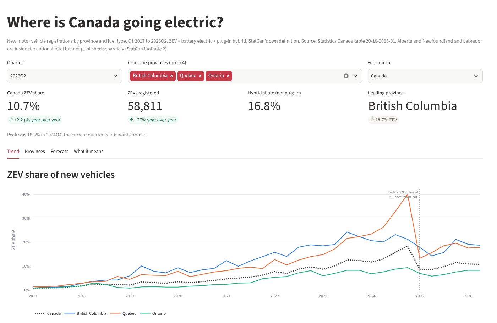

# Where is Canada going electric?

**[Live dashboard](https://canada-ev-adoption.streamlit.app)** · [Code](https://github.com/OkeyaDavid/canada-ev-adoption) · Python · SQL (SQLite) · statsmodels · Streamlit · Plotly

Nine years of Canadian new-vehicle registrations, by province and fuel type, with a
four-quarter forecast and what the pattern means for an automaker's dealer network.



## The question

Where, and how fast, is Canada actually switching to electric vehicles, and what should a
carmaker do about it?

## Key findings

1. **The market peaked and broke.** National ZEV share hit **18.3% in 2024Q4**, then
   fell to **8.6% in 2025Q2**, a drop of
   9.7 points in two quarters, when the federal iZEV
   programme paused and Quebec cut its rebate in January 2025. It has recovered only to
   **10.7% in 2026Q2**.
2. **Quebec carried the fall.** Its annual ZEV share went from
   30.9%
   in 2024 to
   16.8%
   in 2025, a 14.0-point swing, against 5.1 points nationally.
3. **Three provinces are the market.** Quebec, Ontario and British Columbia
   took **95%** of all ZEVs registered in the last four quarters.
4. **Buyers moved down the ladder, not out.** Non-plug-in hybrids rose from
   9.1% of new registrations in 2024 to
   15.4% in 2026, straight through the cuts.
5. **The forecast does not beat a naive baseline, and the README says so.** See below.

## National picture

| Year | ZEV share | Hybrid share | New registrations |
|---|---|---|---|
| 2017 | 0.97% | 1.17% | 2,037,744 |
| 2018 | 2.24% | 1.31% | 1,975,592 |
| 2019 | 2.90% | 2.00% | 1,931,981 |
| 2020 | 3.52% | 2.69% | 1,545,625 |
| 2021 | 5.25% | 4.82% | 1,646,812 |
| 2022 | 8.17% | 5.36% | 1,513,105 |
| 2023 | 11.01% | 7.91% | 1,714,999 |
| 2024 | 14.63% | 9.12% | 1,853,441 |
| 2025 | 9.53% | 12.32% | 1,867,797 |
| 2026 | 10.78% | 15.39% | 945,274 |

## Provinces, last four quarters

| Province | ZEV share | Share of Canada's ZEVs | New registrations |
|---|---|---|---|
| Quebec | 18.32% | 45.1% | 456,820 |
| Ontario | 7.59% | 28.7% | 701,280 |
| British Columbia | 18.56% | 21.0% | 209,712 |
| Manitoba | 5.90% | 1.8% | 55,870 |
| Nova Scotia | 4.72% | 1.4% | 54,612 |
| New Brunswick | 4.58% | 1.1% | 42,708 |

Alberta and Newfoundland and Labrador are inside the national total but not published
separately (StatCan footnote 2: data-sharing agreements). Nunavut and the territories are
small enough that their rates swing on a handful of vehicles.

## The forecast, honestly

Damped-trend exponential smoothing from 2021Q1, four quarters ahead, with
an 80% interval. In a rolling back-test over 5 origins it missed by
**5.56 percentage points** on average against
**4.43 points** for a naive "same as last quarter" guess, so **it does
not beat the baseline**, and the dashboard says so on the forecast tab.

That is not a tuning failure. The series contains a policy break: no model fitted on past
share can anticipate a government cutting a rebate. The honest deliverable is the interval
under unchanged policy, plus the policy calendar as the real planning input.
`python src/forecast.py --bench` reproduces the comparison across training windows.

## Approach

1. **Clean** (`src/clean.py`): read 8.1M rows in chunks, keep national and provincial totals
   only, map fuel labels to codes, convert `REF_DATE` to quarters, load into SQLite. The
   script fails loudly unless national totals match StatCan's published figures
   (Q2 2026: 547,673 registrations, 58,811 ZEVs) and BEV + PHEV equals StatCan's own ZEV
   subtotal in every quarter.
2. **Analyse** (`sql/02_analysis.sql`, 8 queries): shares by province and year, year-over-year
   change, peak-to-latest gaps, fuel mix, and a before/after comparison of the 2025 cuts.
   Uses CTEs and window functions (`RANK`, `ROW_NUMBER`, `MAX OVER`).
3. **Forecast** (`src/forecast.py`): ETS with a rolling-origin back-test against a naive
   baseline.
4. **Dashboard** (`app.py`): Streamlit and Plotly, with the January 2025 policy break marked
   on every time series.

## Run it

```bash
git clone https://github.com/OkeyaDavid/canada-ev-adoption.git && cd canada-ev-adoption
python3 -m venv .venv && source .venv/bin/activate
pip install -r requirements.txt
# optional, to rebuild from source: download the table into data/raw/
#   https://www150.statcan.gc.ca/n1/tbl/csv/20100025-eng.zip
python src/clean.py        # ~15s; verifies against StatCan's published totals
python src/run_sql.py      # the 8 analysis queries
python src/forecast.py --bench
streamlit run app.py
```

`data/ev.db` is committed (small), so the dashboard runs without the 1.4 GB raw extract.

## Limitations

- Registrations are a proxy for sales, not the same thing.
- Two provinces are missing from the provincial breakdown (footnote 2 above).
- The forecast assumes policy stays as it is, which the last two years suggest is optimistic.
- Quarterly data cannot see within-quarter pull-forward: the Q4 2024 Quebec spike is partly
  buyers racing a deadline, which inflates the peak and deepens the fall.

---
Built by David Okeya · [LinkedIn](https://www.linkedin.com/in/okeyadavid) ·
Data: [Statistics Canada table 20-10-0025-01](https://www150.statcan.gc.ca/t1/tbl1/en/tv.action?pid=2010002501)
